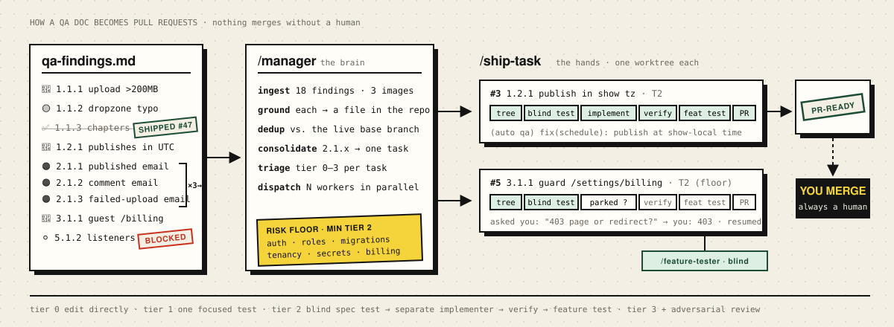
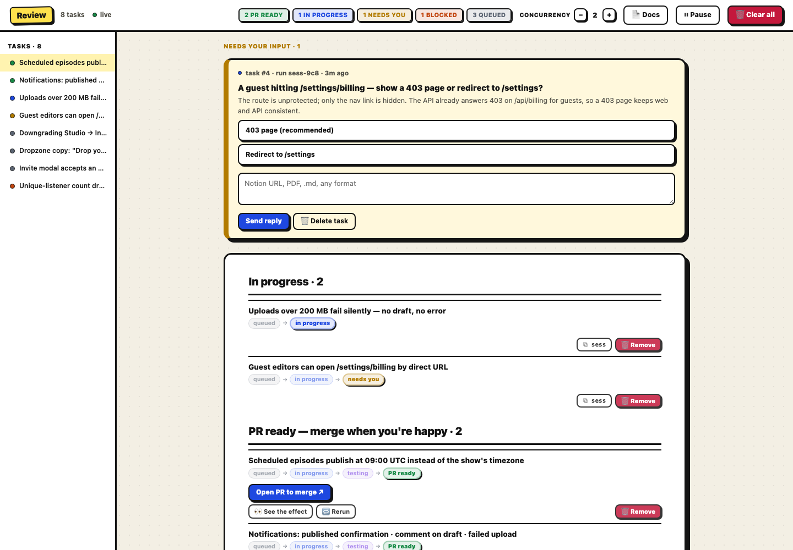

# Shipyard

Shipyard is a set of three Claude Code skills that take work from "someone noticed a problem" to a tested, PR-ready branch — without you in the loop until it's time to merge.

- **`/ship-task`** — send one task and walk away. Isolated git worktree → risk-tiered pipeline → pushed branch and open PR. It never merges.
- **`/manager`** — the batch brain above it. Hand it a Notion page, a QA PDF, a markdown file, or a typed list; it grounds every item in your repo, drops what's already shipped, dedupes, triages, and dispatches parallel `/ship-task` runs — with a localhost control panel for the few questions only you can answer.
- **`/feature-tester`** — the independent verifier. A fresh agent that never saw the implementation writes one integration test of the key behavior; the builder fixes until it's green.

Extracted from a pipeline that has been turning QA reports into merged PRs on a production codebase since July 2026.



**▶ [Try it in your browser](https://henry-shan.github.io/shipyard/)** — run `/manager` on the sample QA doc and watch it become PR-ready branches: findings get stamped, workers pick up tasks, one of them parks and asks *you* a question. Nothing is installed; no agent runs. The second tab routes any task you type through the real risk-floor rules.

## Table of Contents

- [How it works](#how-it-works)
- [Installation](#installation)
- [The basic workflow](#the-basic-workflow)
- [What's inside](#whats-inside)
- [Security — read before first use](#security--read-before-first-use)
- [Philosophy](#philosophy)
- [Updating](#updating)
- [License](#license)

## How it works

What a batch looks like from the terminal — this is the sample doc in `examples/`, a fictional podcast-hosting app:



A `/ship-task` run starts by classifying the task and picking a lane:

| Tier | Signal | What runs |
|---|---|---|
| 0 · trivial | docs, copy | edit directly |
| 1 · small | one obvious fix | one focused test, then the fix (TDD, no subagents) |
| 2 · standard | feature / bugfix | **blind spec-only test agent** (never sees the implementation) → separate implement agent → hard verify gate → independent feature test |
| 3 · large / ambiguous | multi-file, unclear spec | Tier 2 plus adversarial review; stops and asks if acceptance criteria can't be tested |

A **risk floor** forces anything touching auth, tenancy, migrations, or payments to Tier 2 or higher. Doubt tiers up, never down. Every tier lands the same way: verify gate → feature test → branch → push → PR → stop.

`/manager` adds the layer above: it normalizes whatever you hand it into discrete findings, **grounds** each one in the actual code and the live base branch (it never guesses about schema or routes), runs a deterministic git-based pre-filter plus judgment to drop work that already shipped, consolidates duplicates, assigns a tier, and dispatches. Questions a running agent can't answer from the repo surface in one inbox on the panel; your answer flows back into the still-running session. Everything else proceeds.

## Installation

### Claude Code

Paste this into Claude Code:

```
set up https://raw.githubusercontent.com/Henry-Shan/shipyard/main/install.md
```

The agent clones this repo to `~/.claude/shipyard`, symlinks the three skills into `~/.claude/skills/`, checks prerequisites (`python3` ≥ 3.9 — macOS's built-in one is enough; `git`; the `claude` CLI; `gh` for PR mode), offers to install anything missing, and runs the offline self-tests. No project questions at this stage.

### Manual

```bash
git clone https://github.com/Henry-Shan/shipyard ~/.claude/shipyard
for s in ~/.claude/shipyard/skills/*/; do ln -s "$s" ~/.claude/skills/"$(basename "$s")"; done
cp ~/.claude/skills/manager/config.example.json ~/.claude/skills/manager/config.json
```

Also works with [`npx skills add Henry-Shan/shipyard`](https://github.com/vercel-labs/skills) thanks to the standard `skills/<name>/SKILL.md` layout. The skills must stay siblings — `ship-task` and `feature-tester` resolve `manager/skill_config.py` by relative path.

### Requirements

macOS or Linux · `python3` ≥ 3.9 (stdlib only, no pip installs) · `git` · the `claude` CLI · `gh` (PR mode only; `local` mode never pushes) · optional: poppler for PDF ingest, a Notion connector for Notion ingest.

## The basic workflow

```
cd /your/repo && claude
/manager
```

The first run in a project asks the few questions that matter — repo path, base branch, web frontend or not, PR vs. local mode — and writes a per-project `config.json`. Then it opens the panel at `http://127.0.0.1:4317` and asks what to work on: a Notion URL, a PDF or markdown path, or tasks typed straight in. Or skip the question:

```
/manager ~/Desktop/qa-findings.pdf
```

Watch the batch run. Answer the occasional preference question from the inbox. Click **Test this branch** to boot any run's worktree on its own port. Merge finished PRs from GitHub.



*The control panel at `127.0.0.1:4317` — a stdlib Python daemon, no build step. Shown here with the sample doc's batch in flight.*

One task, no orchestration:

```
/ship-task "add a CSV export button to the items table"
```

Multiple projects share one panel — switch or add projects from the **Review** title without a `/manager` session. Answering the panel's task question on the website with no session open makes the daemon launch one, headless (see Security).

### Configuration

One file per project, written by the first-run interview (`config.example.json` is the template):

```json
{
  "repo": "/abs/path/to/target/repo",
  "base_branch": "main",
  "worktree_dir": "~/.manager-worktrees",
  "dispatch_cap": 2,
  "setup_command": "npm install && npm run build",
  "dev_command": "npm run dev",
  "dev_port": 3000,
  "verify_command": "npm run lint && npm test",
  "env_files": [],
  "risk_keywords_extra": [],
  "push_mode": "pr"
}
```

`push_mode` is the finish line: `pr` pushes each branch and opens a GitHub PR; `local` stops at a committed local branch — nothing leaves your machine. Env vars (`MANAGER_REPO`, `MANAGER_CAP`, `MANAGER_BASE_BRANCH`, …) override the file. Optionally fill in `skills/ship-task/BUILDER_PLAYBOOK.md` with your repo's architecture and footguns — every implement agent reads it first.

## What's inside

```
skills/
  manager/          SKILL.md · managerd.py (panel + API + dispatcher) · manager_core.py (SQLite queue + inbox)
                    dedup_index.py · notion_ingest.py · dispatch.sh · auto-manager.sh · skill_config.py · ui/
  ship-task/        SKILL.md · setup-worktree.sh · verify.sh · risk_floor.py · teardown-worktree.sh · BUILDER_PLAYBOOK.md
  feature-tester/   SKILL.md · run-focused-test.sh · feature-test-gate.sh
examples/           demo-qa-findings.md — a sample work source to try /manager on
install.md          the agent-readable installer
```

| Skill | Role |
|---|---|
| **manager** | Ingests the work source (Notion, PDF + screenshots, markdown, folder, typed list), grounds every candidate in the repo, drops already-shipped work, consolidates duplicates, triages to a tier, dispatches and supervises headless `/ship-task` runs. Ships a localhost daemon: live task board, the source doc with per-finding progress, a suggestions inbox, per-branch "Test this" buttons, per-project settings. |
| **ship-task** | Builds one feature or fix in its own worktree off the freshly-pulled base branch, with env files symlinked and the project setup command run. Risk-aware routing; blind spec test; separate implementer; `verify.sh` gate; ends at a pushed branch and open PR with a manual test guide. |
| **feature-tester** | After the build is green, a fresh agent with no implementation context writes one focused integration test of the key user-facing behavior; the builder re-runs and fixes until it passes; one independent confirmation run seals it and the test is committed as a regression guard. |

## Security — read before first use

**The manager dispatches autonomous agents with permission checks disabled.** `skills/manager/dispatch.sh` launches headless `claude` runs with `--dangerously-skip-permissions` — a headless run would otherwise stall on its first tool prompt. Those agents can edit files, run commands, push branches, and open PRs in the configured repo. Treat a batch like giving a contractor push access to feature branches.

This includes the panel: answering the task question on the website — with no `/manager` session open — makes the daemon launch the same kind of unattended agent (`auto-manager.sh`). There is no confirmation step in between.

What bounds them:

- **Never merge.** Every run stops at PR-ready. Merging is always a human action from GitHub; there is no merge code anywhere in the package.
- **Never push to the base branch.** The only path in is a merged PR.
- **Isolated worktrees.** All edits happen under `worktree_dir`, never in your checkout.
- **Two gates before any commit:** `verify_command` must pass, and the independent feature test must pass.
- **Local mode** (`push_mode: "local"`) keeps everything on your machine — no `gh`, no push, no PR.
- Tighter posture available: `MANAGER_PERMS="--permission-mode acceptEdits"`.

Read `skills/manager/dispatch.sh` before your first batch. It is about 150 lines and it is exactly what runs on your machine.

## Philosophy

- **Autonomous by default, investigate before asking.** Only a genuine preference the agent cannot determine from evidence reaches you — one plain-language question with a recommendation.
- **Blind tests, separate implementer.** A tester primed by the builder's reasoning "verifies" the builder's wrong assumptions. The spec test and the feature test are written by agents that never see the implementation.
- **Risk sets the process, not optimism.** The risk floor is deterministic; the tier only ever goes up.
- **Never re-dispatch shipped work.** Grounding and dedup against the live base branch run before anything is queued.
- **Stop at PR-ready.** Merging is the one step that stays human.
- **Report what couldn't be done** — blocked or needs-scope — instead of guessing.

## Updating

Paste the install line again; it's idempotent. The clone at `~/.claude/shipyard` is pulled, newly added skills are linked, and your `config.json`, queue database, and run history are gitignored and survive. Manual equivalent:

```bash
git -C ~/.claude/shipyard pull
```

## License

MIT
